<p align="center">
  
</p>

<p align="center">
  <b>A whole desktop for Arch Linux and Hyprland.</b><br>
  Its own shell, apps and settings, one theme across every program,<br>
  and an installer that puts it on a machine.
</p>

<p align="center">
  
  
  
  
</p>

https://github.com/user-attachments/assets/4a7dac16-6943-4acf-9627-7ff15657b959

## What it is

- **The shell** — a bar or a floating island, popups for every module, a hub,
  notifications, OSD, lock screen, a polkit prompt. Written in
  [Quickshell](https://quickshell.org), one process.
- **Apps of its own** — Files, Music, Capture, Task Manager, Cleaner,
  Backups, Clipboard, Packages, VirusTotal, a launcher, a keybinds sheet,
  Overview, a window switcher. Same look, same keys.
- **Shell Manager** — every option in one window (`Super + S`), with search:
  the look, the bar, modules, windows, network, Bluetooth, displays.
- **Themes** — 13 of them, each with a light or dark twin. One switch
  recolours Hyprland, the shell, kitty, Neovim, mako, the cursor and the
  wallpaper.
- **Window modes** — tiling, floating (with a taskbar) or scrolling, switched
  live.
- **An installer** — a wizard picks what goes on the machine, detects the
  hardware, links the configs file by file and keeps them healthy.

## Gallery

| | |
|:---:|:---:|
| 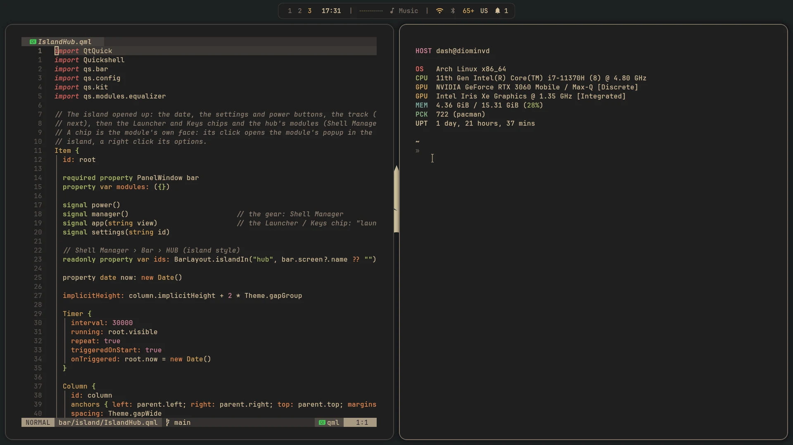 | 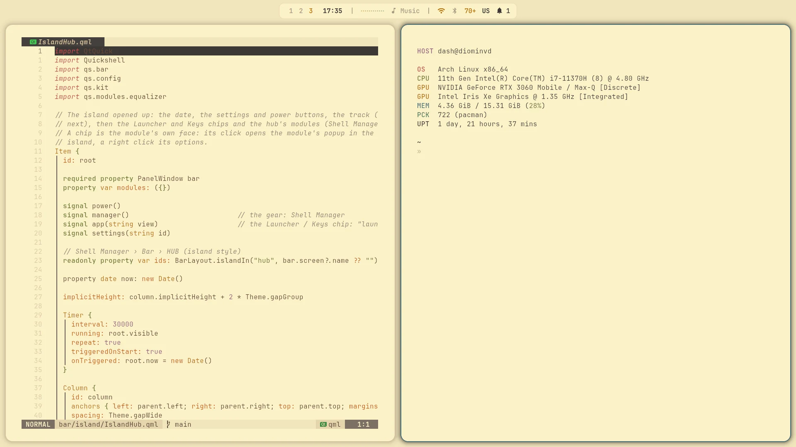 |
| Desktop · Gruvbox dark | Desktop · Gruvbox light |
| 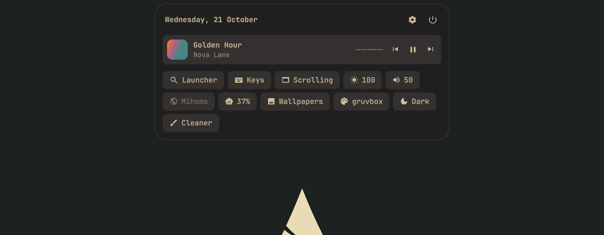 | 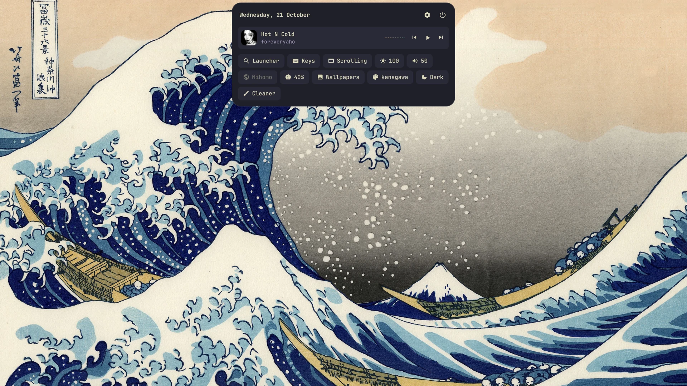 |
| The island's hub: the track, quick chips, modules | The same hub in Kanagawa |
| 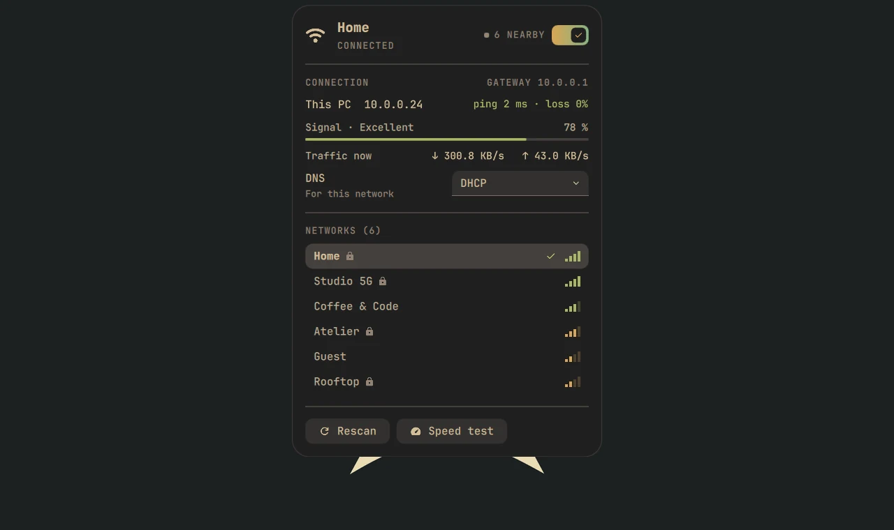 | 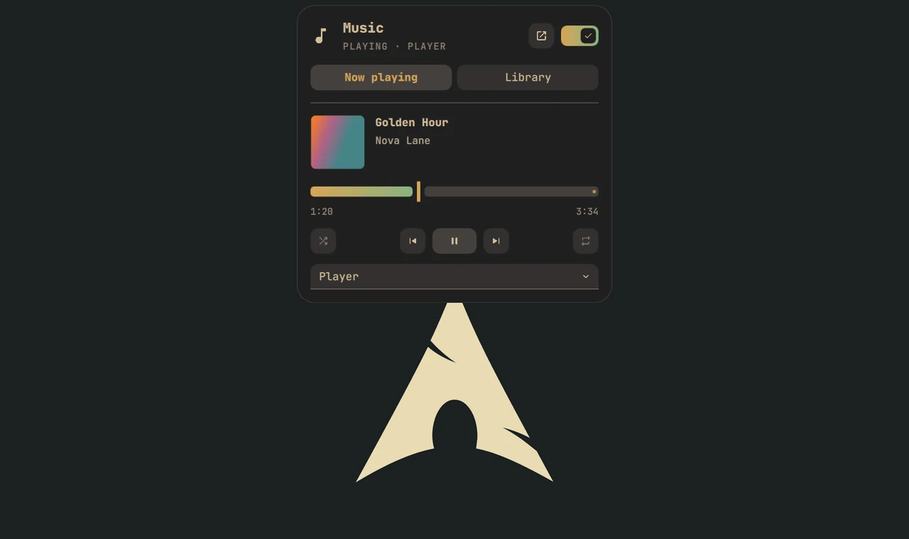 |
| Wi-Fi: networks, DNS, a speed test | Music: what plays, the queue, the library |
| 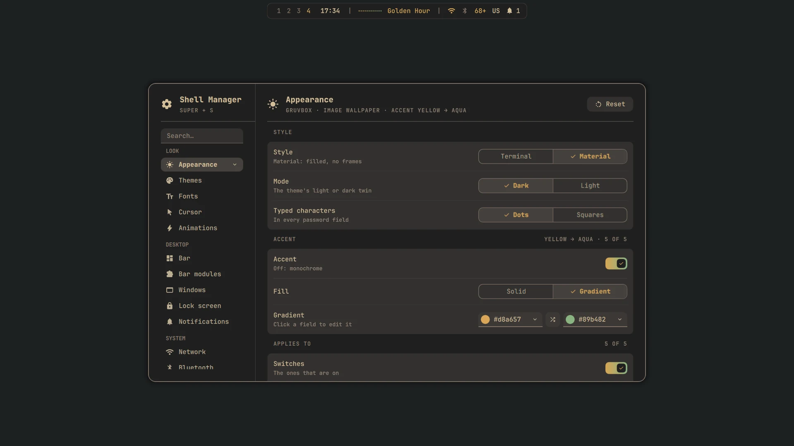 | 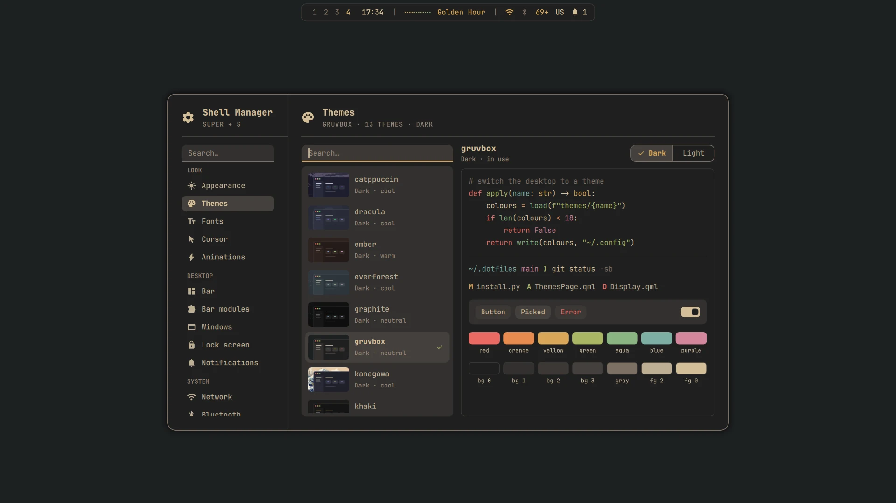 |
| Shell Manager › Appearance | Shell Manager › Themes |
| 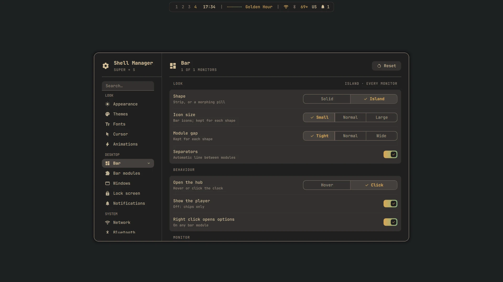 | 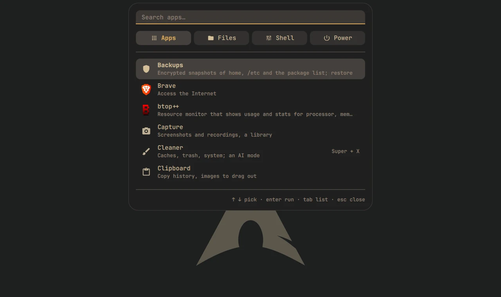 |
| Shell Manager › Bar | The launcher: apps, files, shell, power |
| 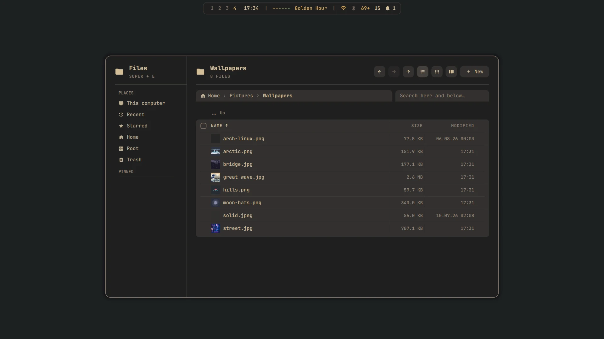 | 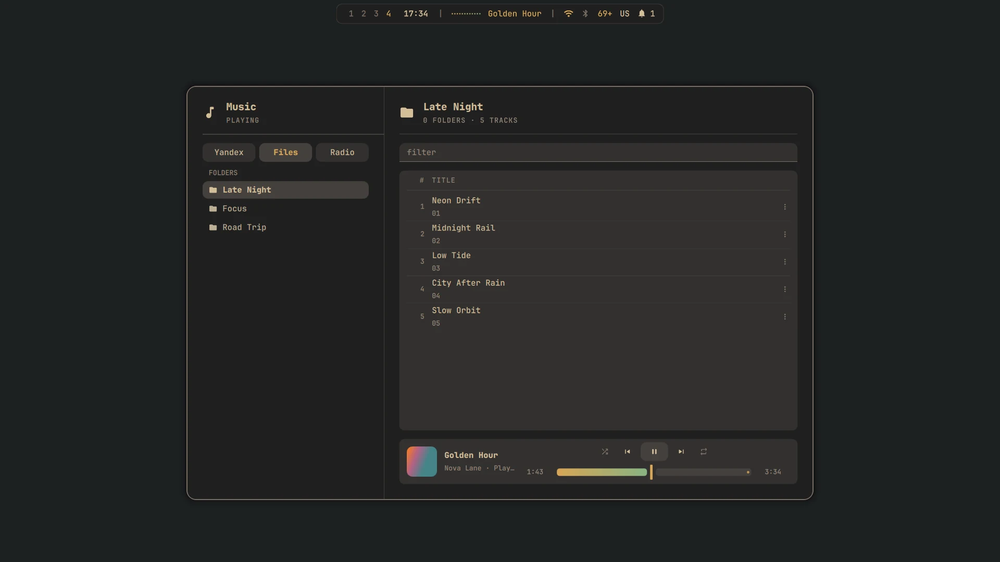 |
| Files | Music: Yandex Music, local folders, radio |

## Install

Arch Linux or a derivative (EndeavourOS, CachyOS…), a user with sudo, `git`
and `python` ≥ 3.11. The repo lives in `~/.dotfiles`:

```bash
sudo pacman -S --needed git python
git clone https://github.com/diominvd/vdx.git ~/.dotfiles
cd ~/.dotfiles
./install.py install
```

The wizard shows the machine, the detected hardware, every component by group
(desktop, terminal, editor, apps, music, network, AI), the theme and the
keyboard, then a summary. Nothing is written before that. Then `setup`
installs the packages (yay is built when missing), links the configs, copies
the `/etc` files (a diff first) and enables the services; each step skips
what is already in place. Boot settings (the NVIDIA driver, mkinitcpio) are
only listed for you.

Log in from a tty and run `start-hyprland`.

Without the wizard: `./install.py components set <name>…`, then
`./install.py setup` (`--dry-run` shows the plan).

## Keys

| Key | |
|---|---|
| `Super + S` | Shell Manager |
| `Alt + Space` | launcher |
| `Super + B` | every key, searchable |
| `Super + Q` | terminal |
| `Super + E` | Files |
| `Super + O` | Overview |
| `Super + Shift + S` · `Super + P` | capture a part · the whole screen |
| `Ctrl + Shift + Esc` | Task Manager |
| `Super + Z` | lock |

## Commands

`./install.py` alone opens a menu.

| Command | |
|---|---|
| `install` | the wizard, then `setup` |
| `setup [--dry-run]` | install or bring up to date what is chosen |
| `update` | `git pull`, then `setup` |
| `doctor` | this machine's health, each problem with its fix |
| `components [list\|add\|remove\|set]` | what is on this machine |
| `machine [show\|detect]` | the detected hardware (`.machine.toml`) |
| `theme list\|current\|set <name>` | themes; `set` re-links and reloads |
| `link` · `verify` · `status` | links: create · check · per package |
| `check [group…]` | the repo itself: links, syntax, themes, components, tests, hypr, shell, repo |
| `uninstall [--system]` · `rollback` | take it off · put replaced files back |

Destructive commands ask first; `-y` answers yes. All of them:
[docs/repo/commands.md](docs/repo/commands.md).

## Inside

| | |
|---|---|
| Desktop | Hyprland (Lua config), Quickshell, mako |
| Shell | zsh, Oh My Zsh, Starship |
| Editor | Neovim |
| Terminal | kitty, tmux |
| Music | MPD, ncmpcpp; Yandex Music and radio CLIs (optional) |
| VPN | Mihomo + `vpn` (optional) |

```
install.py        the installer (code in installer/, tests in tests/)
components.toml   what can be installed: one entry per checkbox
home/             -> ~/
packages/         -> ~/.config/<pkg>/   (package.toml overrides the target)
themes/<t>/       overlay of packages/, the active theme wins per file
system/           copied into / with sudo
wallpapers/       per theme
docs/             how it works and how to change it
```

Themes: catppuccin, dracula, ember, everforest, graphite, gruvbox (the
source), kanagawa, khaki, mono, nord, onedark, rosepine, tokyonight.

The shell up close — every app, its keys and IPC:
[packages/quickshell/shell](packages/quickshell/shell/README.md).

## Secrets

Nothing secret is in git. API keys go to `~/.config/secrets/env` (template:
[templates/secrets/env.example](templates/secrets/env.example)); tokens of
GitHub, Yandex Music and the Mihomo subscriptions stay in their programs'
config folders, ignored by git.

## Troubleshooting

- Something off: `./install.py doctor` names it and the command that fixes it.
- A real file was in the way of a link: it is in
  `~/.local/state/dotfiles/backup/<time>/`; `./install.py rollback` puts it back.
- A new file isn't picked up: `./install.py link`.
- No bar after a crash: the shell restarts itself; if it doesn't, see
  [the shell's README](packages/quickshell/shell/README.md#when-the-shell-is-gone).
- Logs of each setup: `~/.local/state/dotfiles/setup-<time>.log`.

## Wallpapers wanted

Each theme ships with one or two wallpapers, and its light twin with none.
More are very welcome, for any theme, dark or light — a PR with a picture:
[wallpapers/README.md › Adding one](wallpapers/README.md#adding-one).

## Changing it

How it is built and the rules for changes: [docs/README.md](docs/README.md).

[MIT](LICENSE) © diominvd
