# shell

Quickshell config (`qs -c shell`): the bar, the shell's apps and the Shell
Manager. Code rules: [CLAUDE.md](CLAUDE.md).

## Overview

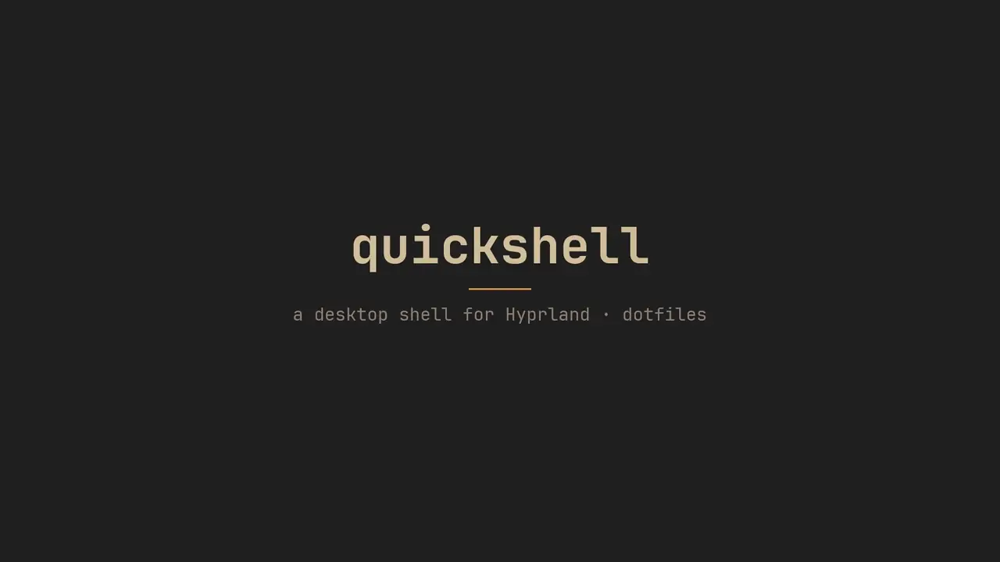

Full quality: [shell-demo.mp4](../../../docs/shell/shell-demo.mp4).

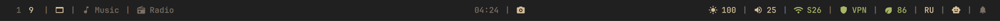

<table>
  <tr>
    <td colspan="2">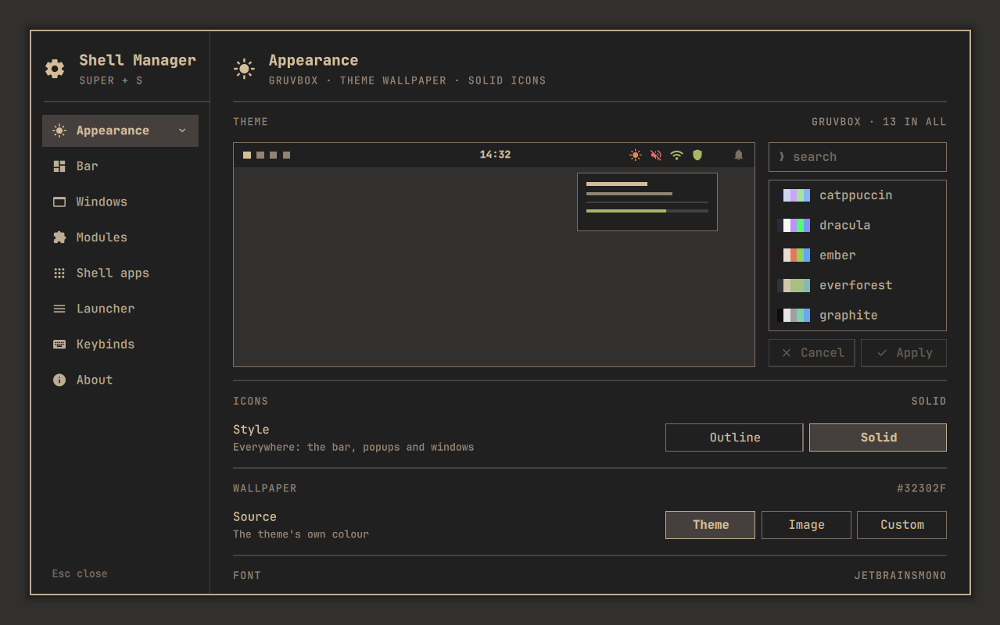 Shell Manager › Appearance: theme, icons, wallpaper, font</td>
  </tr>
  <tr>
    <td colspan="2">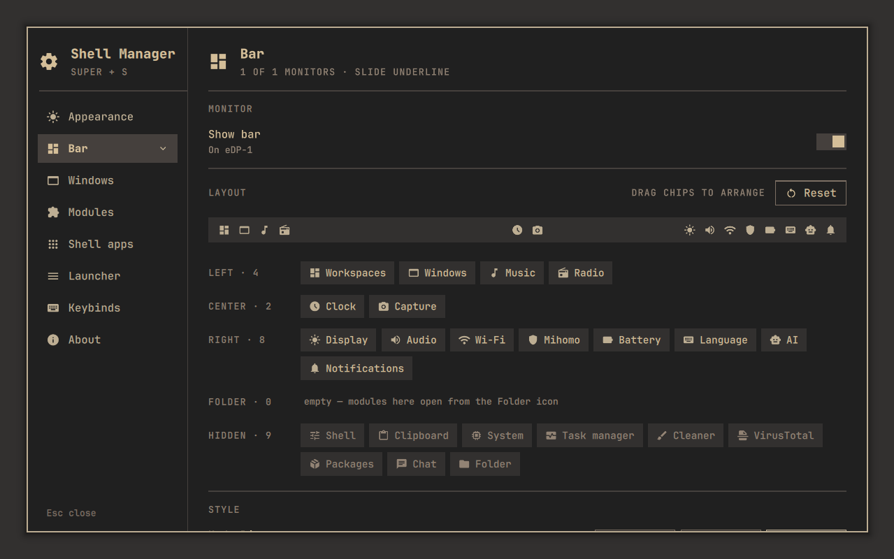 Shell Manager › Bar: modules dragged between zones and the Folder</td>
  </tr>
  <tr>
    <td>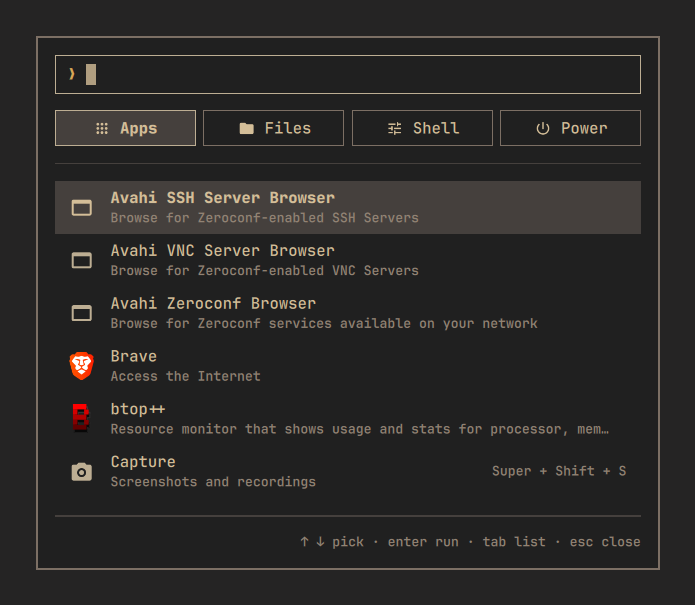 System menu (Super+R)</td>
    <td>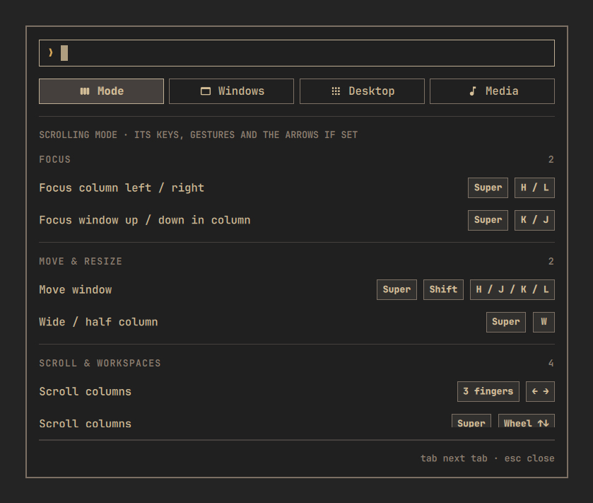 Keybinds (Super+B)</td>
  </tr>
  <tr>
    <td>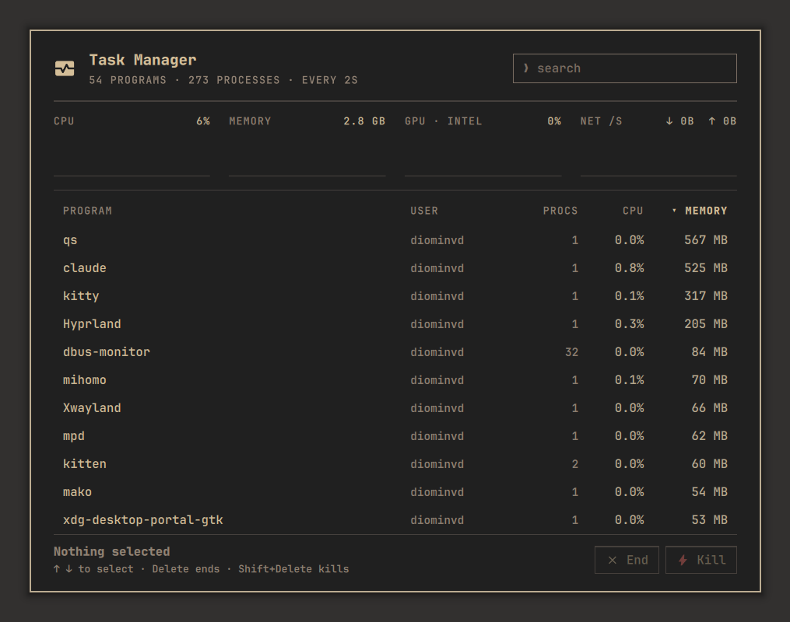 Task manager (Super+D)</td>
    <td>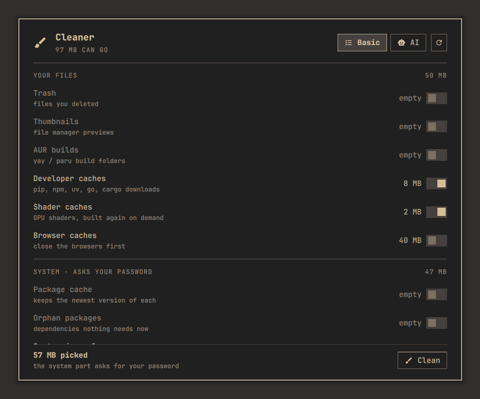 Cleaner (Super+X)</td>
  </tr>
  <tr>
    <td>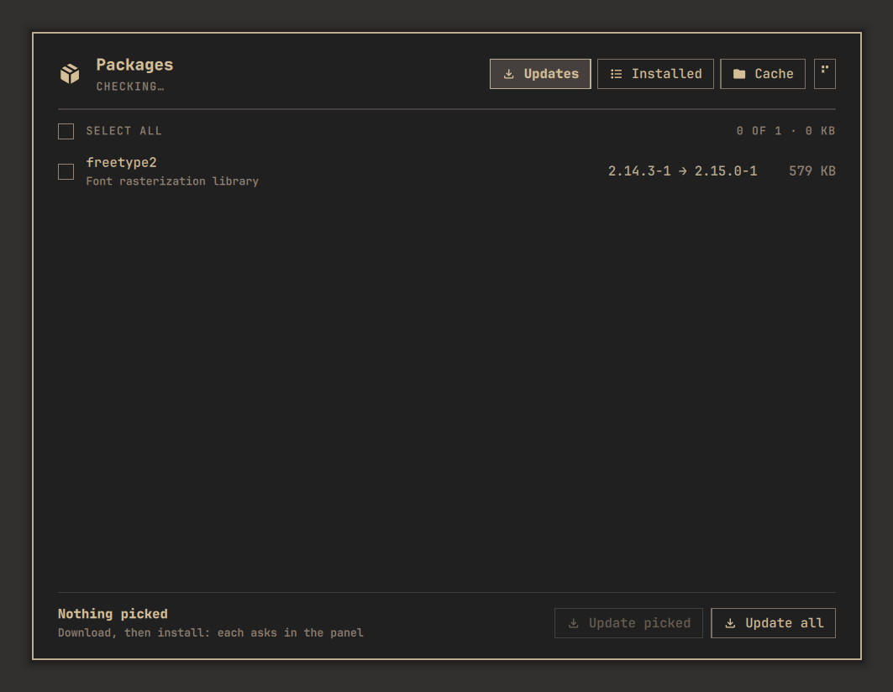 Packages</td>
    <td>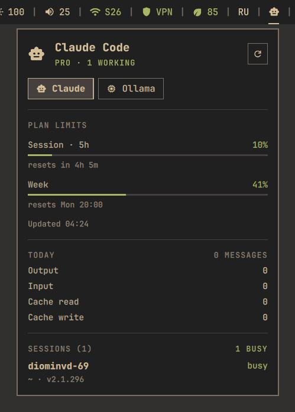 AI: Claude Code limits, Ollama</td>
  </tr>
  <tr>
    <td>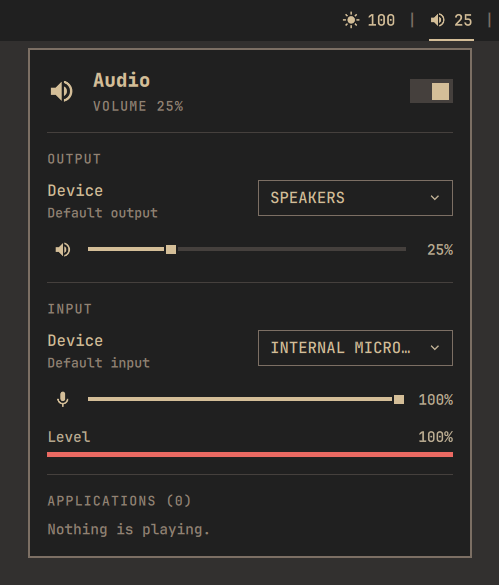 Audio</td>
    <td>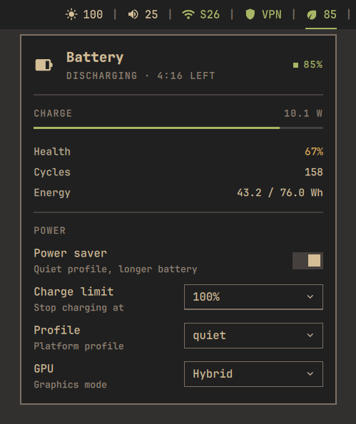 Battery</td>
  </tr>
  <tr>
    <td>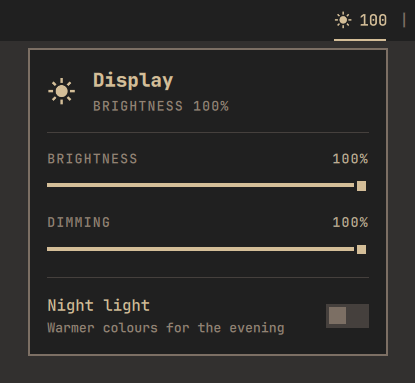 Brightness</td>
    <td>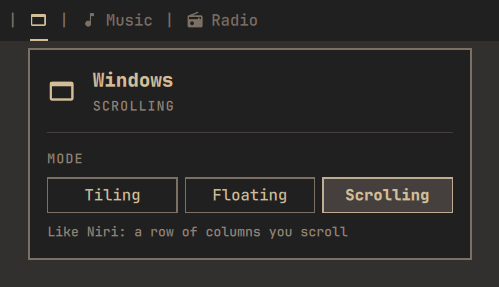 Window mode</td>
  </tr>
  <tr>
    <td>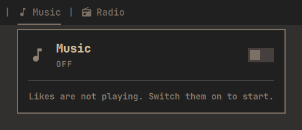 Music</td>
    <td>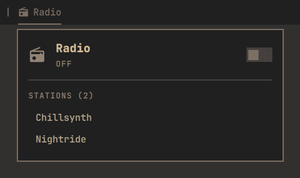 Radio</td>
  </tr>
</table>

Media: `docs/shell/` in the repo root.

## Apps

Registry: `apps/apps.json` (the Shell Manager, the system menu,
`scripts/shellapps.py` and the window rules read it).

| App | Key | IPC |
|---|---|---|
| Shell Manager | Super+S | `shell toggle`, `shell open <page>[:<group or app>]` |
| Task manager | Super+D | `taskmanager toggle` |
| Cleaner | Super+X | `cleaner toggle` |
| Capture | Super+Shift+S | `capture open\|stop\|close` |
| System menu | Super+R | `launcher toggle` |
| Packages | — | `packages toggle` |
| Display | — | `display toggle` |
| VirusTotal | — | `virustotal toggle` |
| Clipboard | — | `clipboard toggle` |
| Keybinds | Super+B | `keybinds toggle\|open\|close` |
| Window switcher | Super+Tab (floating mode) | `switcher toggle\|open\|close` |
| Overview | — | `overview toggle` |
| Lock screen | Super+Z | `lock lock` (options: Shell Manager › Shell apps › Lock screen) |
| Taskbar | — | floating mode only |
| Root prompt | — | polkit agent; asks before every root action |

IPC: `qs -c shell ipc call <target> <function>`. Window mode:
`windowmode set tiling|floating|scrolling`.

## Modules

Bar modules live in `modules/<id>/`; each popup opens with
`qs -c shell ipc call <id> toggle` (except clipboard `clip`, taskmanager
`tasks`, cleaner `clean`, virustotal `scan`, packages `updates`). Order, zones and visibility: Shell Manager
› Bar. Options: Shell Manager › Modules (an app's module: › Shell apps).

Workspaces, Music, Radio, Equalizer, Clock, Themes, Brightness, Audio, Wi-Fi, Mihomo, Battery,
Language, AI, Shell, Notifications, Capture, Clipboard, System, Task manager,
Cleaner, VirusTotal, Packages, Display, Windows, Chat, Folder.

## Controls

Shell Manager › Appearance › Controls: Outlined (framed controls, the
terminal look) or Material (filled controls, no frames or prompt arrows,
a quiet hairline round popups). The island keeps its frame either way.

## Corners

Shell Manager › Appearance › Corners: Sharp, or Round with one radius on a
ticked slider. Everything follows — popups, controls, rows, the island,
Hyprland's windows, mako — and the icons switch to Material Symbols Rounded.

## Island

Shell Manager › Bar › Style › Island: no strip — one pill at the top centre is
the whole bar (`bar/island/`). At rest: LEFT · clock · RIGHT (by default the
workspaces and the equalizer). Resting on the clock or a click opens the hub:
the date, the track and the HUB modules as chips; a chip opens its module's
popup inside the island, with a bubble beside it to the hub (the mouse's
back button too; Escape when it came from the hub). Shell Manager › Bar arranges LEFT, RIGHT, HUB
and HIDDEN, and per monitor its Clock: off with nothing beside it, the island
hides there until it has something to show. Volume / brightness changes and new notifications pass over it
(mako only keeps them: its `island` mode). Equalizer or track: the player.
Right click: power. Middle click: play / pause; wheel: volume.

IPC: `qs -c shell ipc call island hub|media|power|collapse`.

## Requirements

| What | Needs |
|---|---|
| Battery limit | `system/etc/tmpfiles.d/quickshell-power.conf` |
| Power profile | `system/etc/udev/rules.d/90-quickshell-power.rules` |
| Headset mic | `system/etc/tmpfiles.d/headset-mic.conf` |
| Root actions without a password for 5 min | `system/etc/polkit-1/rules.d/50-pkexec-keep.rules` |
| Ollama service switch | `system/etc/polkit-1/rules.d/50-ollama.rules` |
| AI limits | Claude Code login (`~/.claude/.credentials.json`) |
| File scans | `VIRUSTOTAL_API_KEY` (env or `~/.config/secrets/env`) |
| Music likes | Yandex Music token (`~/.config/scripts/yandex-music/token`) |
| Island wave | `cava` (without it the wave is made up) |

System files: `./install.py system install`.

## Files you edit

| File | What |
|---|---|
| `modules/brightness/night_light.json` | night light presets and schedule |
| `modules/wifi/dns_providers.json` | DNS providers: `{label, servers}` |
| `~/.config/scripts/radio/stations.json` | radio stations: `"key": {name, url}` |

State: `~/.local/state/quickshell/by-shell/<id>/` (`settings.json`,
`modules.json`, `layout.json`, …) and `~/.local/state/dotfiles/`
(`window-mode`, `windows.json`, `shell-apps.json`).
