# Wallpapers

The pictures the themes ship with. Shell Manager › Appearance › Wallpaper
picks one per theme, from the theme's folder here, then your own
(`~/.local/share/dotfiles/wallpapers/`), then an optional `common/`.

**Wanted:** more for every theme, dark or light. Each has one or two, the
light twins none — a PR with a picture is very welcome.

## What is here

| Theme | Dark | Light |
|---|---|---|
| **catppuccin** | 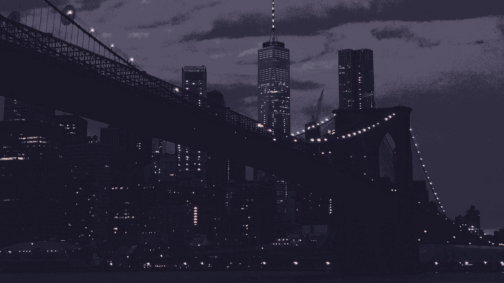 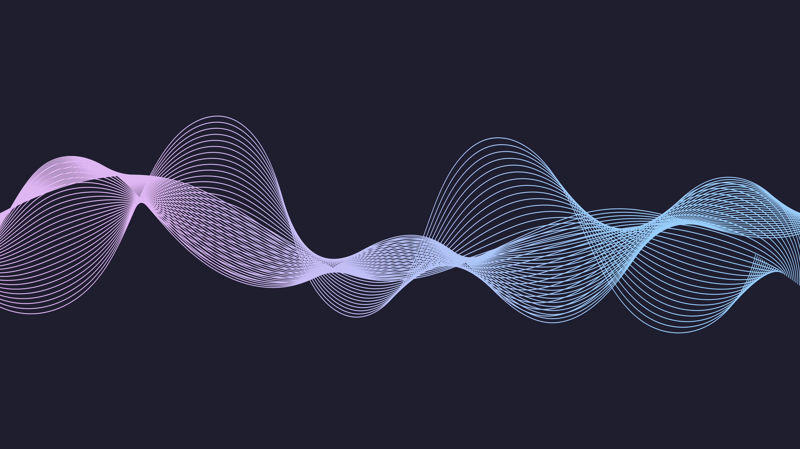 | wanted |
| **dracula** | 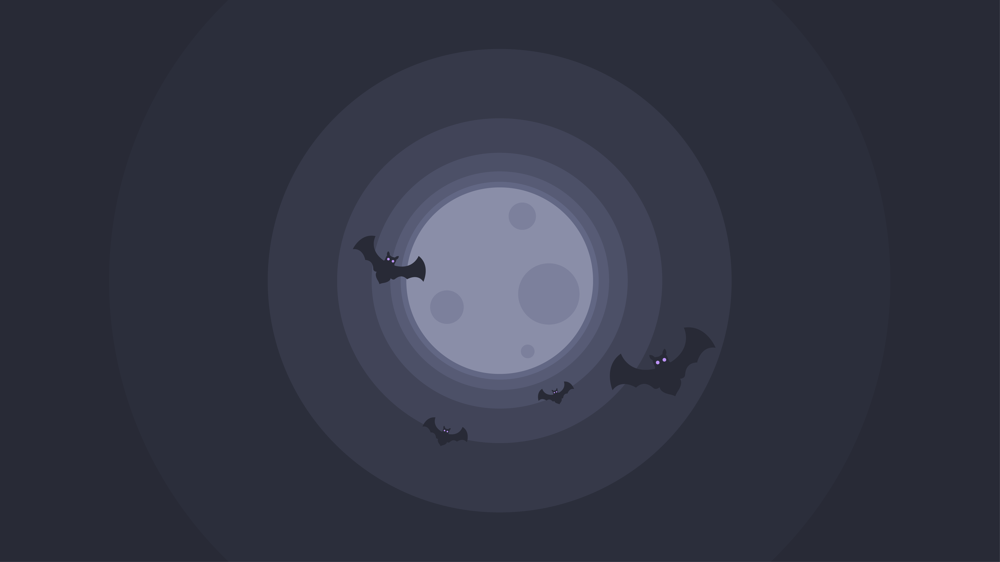 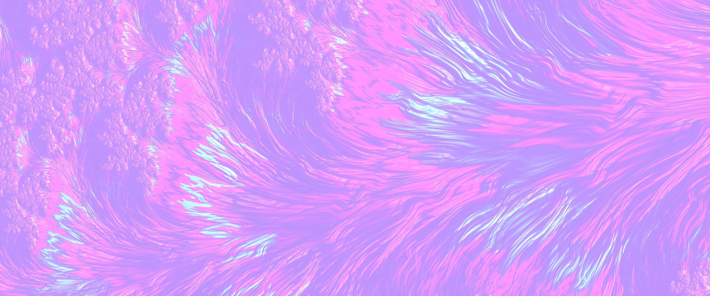 | wanted |
| **ember** | 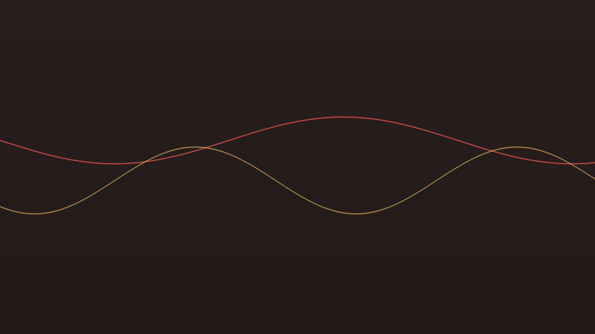 | wanted |
| **everforest** | 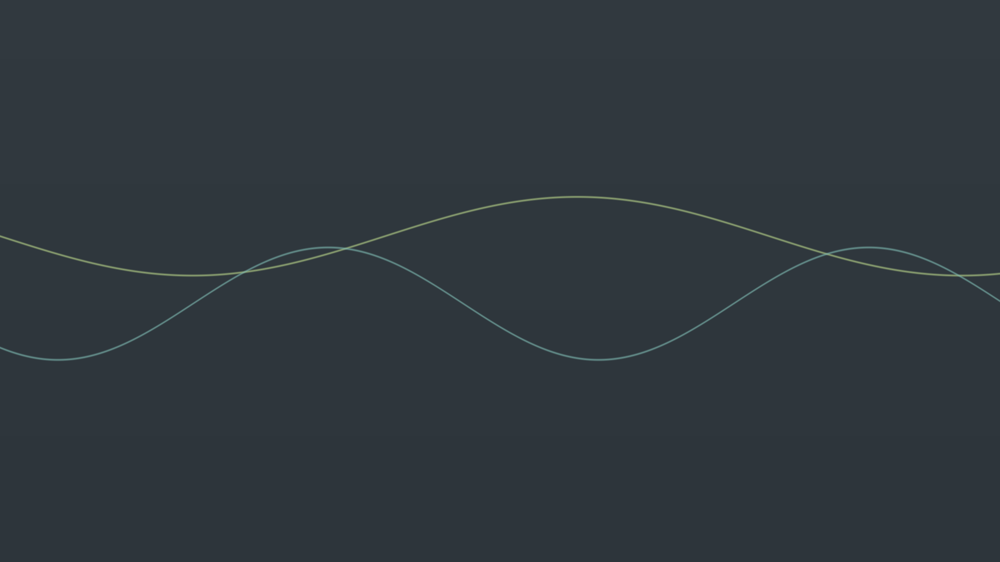 | wanted |
| **graphite** | 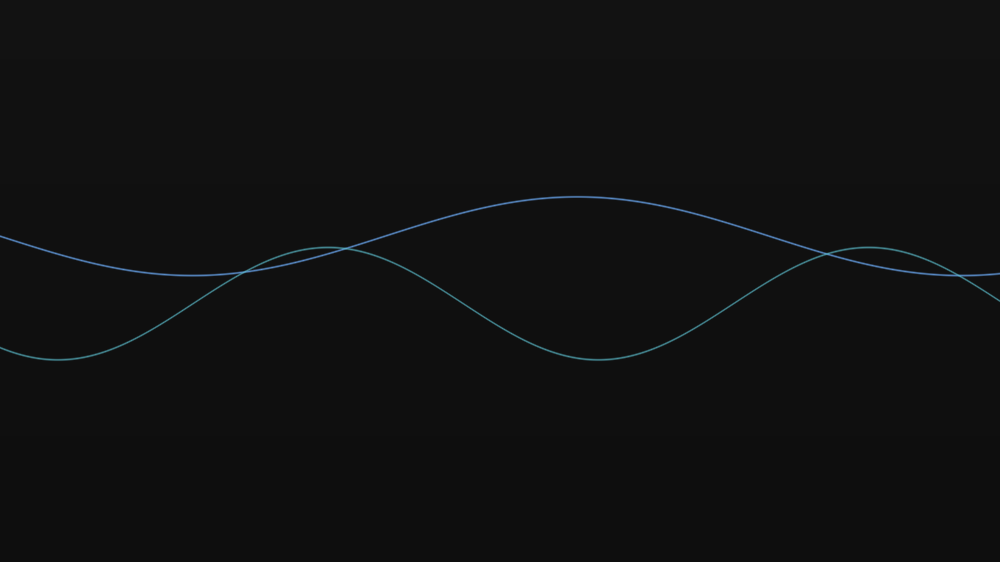 | wanted |
| **gruvbox** | 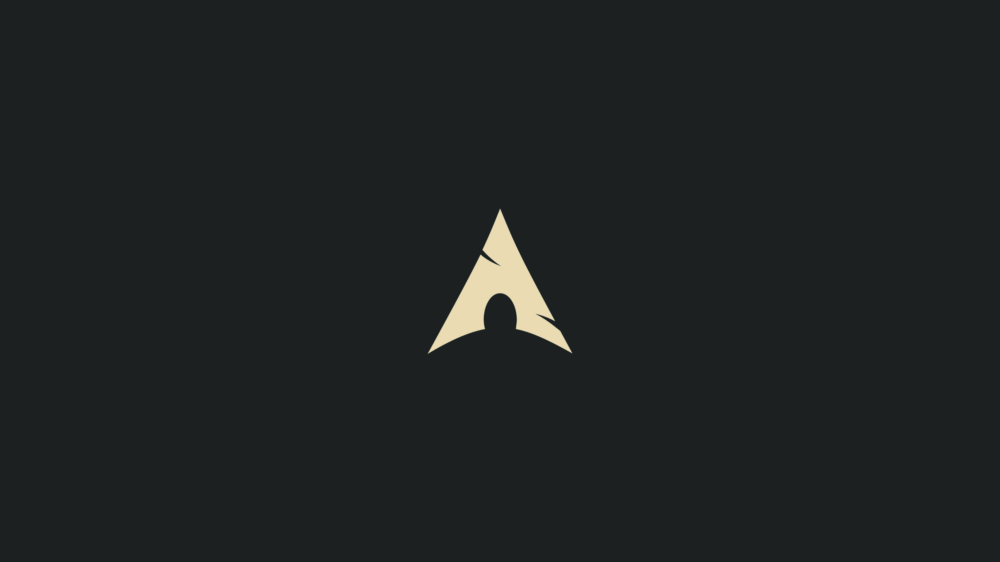 | wanted |
| **kanagawa** | 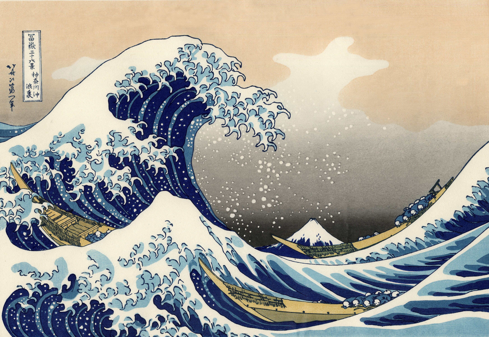 | wanted |
| **khaki** | 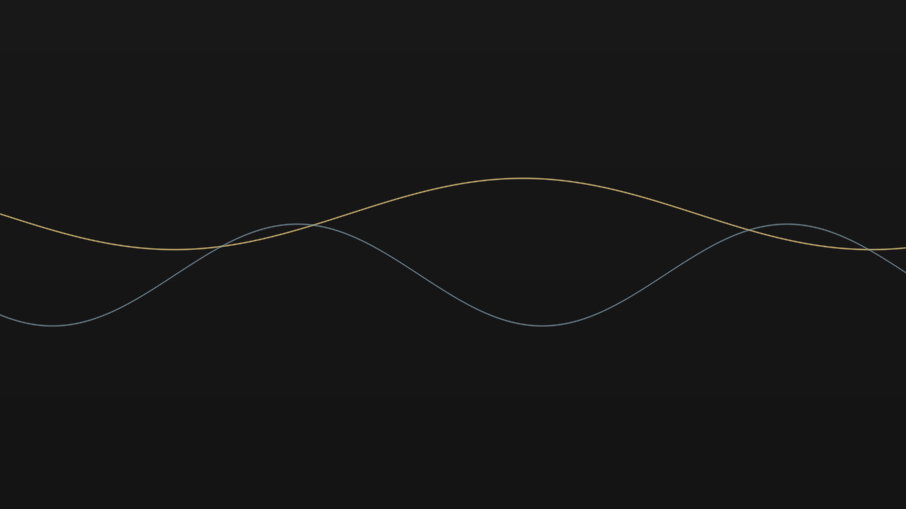 | wanted |
| **mono** | 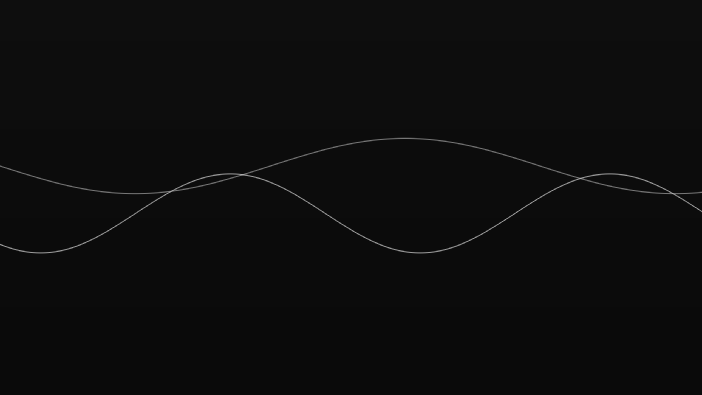 | wanted |
| **nord** | 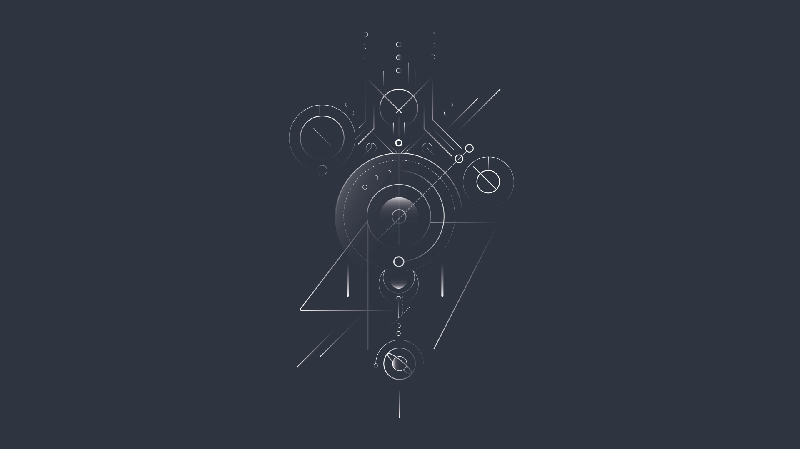 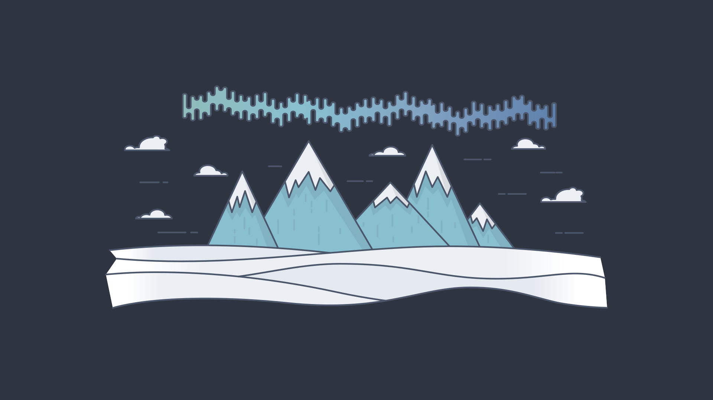 | wanted |
| **onedark** |   | wanted |
| **rosepine** | 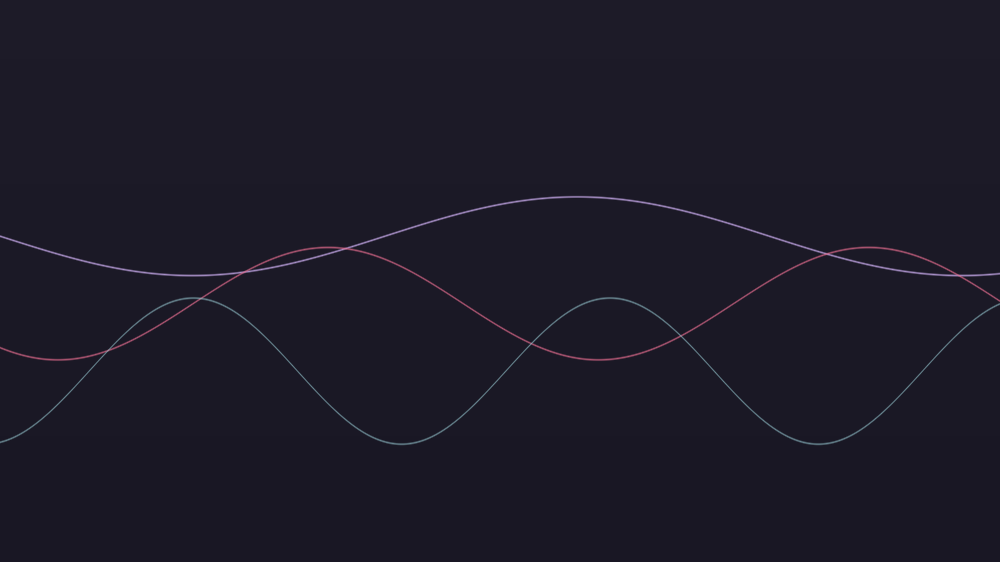 | wanted |
| **tokyonight** | 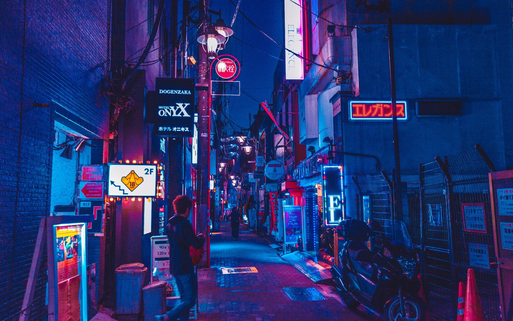 | wanted |

## Adding one

1. Put the file in `wallpapers/<theme>/`, or `wallpapers/<theme>-light/` for
   the light twin. A short kebab-case name: `misty-forest.jpg`.
2. jpg, png or webp, at least 1920×1080, up to ~5 MB.
3. It fits the theme's palette: the colours are in
   `themes/<theme>/kitty/colors.conf` (light: `themes/<theme>-light/…`).
4. In the same PR, add a row to Sources below: where it is from and its
   licence, at least a link to the author.

Several pictures, several themes — one PR is fine.

## Sources

| Theme | Files | From | Licence |
|---|---|---|---|
| catppuccin | `waves`, `bridge` | [iQuickDev/catppuccin-wallpapers](https://github.com/iQuickDev/catppuccin-wallpapers) | MIT |
| nord | `arctic`, `abstract` | [linuxdotexe/nordic-wallpapers](https://github.com/linuxdotexe/nordic-wallpapers) | MIT |
| dracula | `waves`, `moon-bats` | [dracula/wallpaper](https://github.com/dracula/wallpaper) | MIT |
| onedark | `abstract`, `hills` | [Narmis-E/onedark-wallpapers](https://github.com/Narmis-E/onedark-wallpapers) | GPL-3.0 |
| tokyonight | `street` | [Jayy-Dev/Plasma-Tokyo-Night](https://github.com/Jayy-Dev/Plasma-Tokyo-Night) | GPL-3.0 |
| gruvbox | `arch.jpg` | — | MIT |
| kanagawa | `great-wave` (Hokusai, 1831) | [Wikimedia Commons](https://commons.wikimedia.org/wiki/File:The_Great_Wave_off_Kanagawa.jpg) | public domain |
| everforest, rosepine, graphite, khaki, ember, mono | `waves` | generated for this repo in the theme's colours (no licensed set found) | the repo's |

Each repo's licence text travels with the picture's origin; keep the source when
replacing a file.
